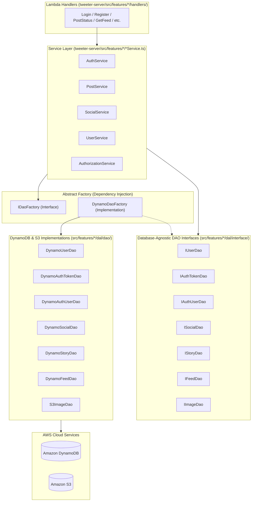

# Project Milestone 4 Part A: Data Access Layer

> **AI usage for this milestone is Level 3 — Partner** (see the [AI Usage Level Definitions](https://cs.byu.edu/department/ai-policy)), an exception to the course default of Level 1.

In this milestone you will implement the rest of your server and complete all of the functionality described in the Course Project overview, including the requirements for authentication tokens and the handling of passwords, using DynamoDB to persist data rather than using hard-coded dummy data, and uploading user profile images to S3.

---

## 1. Official Requirements

Add a data access layer to your server's design. Design and implement a set of DAO classes that support all of the database access needs of your server, as follows:

1. **Database-Agnostic DAO Interfaces**: Define each DAO type using an interface that has no dependencies on a particular underlying database (i.e., the interfaces should be database agnostic). This will allow your server to be easily ported to a different database later if needed.
   - S3 should also have a DAO interface.
2. **Service Layer Refactoring**: Modify your Service classes to use your DAOs to access the database (i.e., no more hard-coded dummy data).
3. **Abstract Factory / Dependency Injection**: Use the Abstract Factory pattern or Dependency Injection to give your Service classes access to the DAO objects they need. Specifically, your Service classes should never call `new` to create a DAO, but instead call an abstract factory to create DAOs, or receive them through dependency injection. Your Service classes should be unaware of what particular database is being used.
4. **DynamoDB DAO Implementations**: Create a package of classes that implement your DAO interfaces using DynamoDB.
   - S3 should also be implemented using a DAO.
5. **DynamoDB Tables & Pre-computed Feeds**: Design and create a set of DynamoDB tables and indexes to store all necessary data.
   - Your design should pre-compute the contents of every user's feed and store it in the database, rather than calculating user feeds dynamically. This will allow user feeds to be retrieved very quickly, and allow your server to meet the project performance requirements.
6. **S3 Image Uploads**: Your data access layer should also support the ability to upload user profile images to AWS S3.
7. **User & Session Management**: Your implementation should meet the "user and session management" requirements in the project overview.
   - Articles about salting and hashing passwords: [Auth0 Password Hashing](https://auth0.com/blog/adding-salt-to-hashing-a-better-way-to-store-passwords) and [LogRocket Bcrypt Guide](https://blog.logrocket.com/password-hashing-node-js-bcrypt/).
   - Install `bcryptjs` (not `bcrypt`, which does not work in AWS Lambda) and `@types/bcryptjs`.
   - **Authentication in every Lambda**: Authenticate the user in every Lambda (except login/register). Use an `AuthorizationService` to validate tokens against DynamoDB. If unauthorized, throw an error mapping to HTTP 401 via API Gateway regex (`[Unauthorized] ...`).
8. **Design Patterns & Code Reuse**: Avoid duplicating code by using inheritance, generic types, composition/delegation, Template Method pattern, Strategy pattern, passing functions as parameters, etc.
9. **Data Pagination (>10 Items)**: At least one tab should be populated with more than 10 items so scrolling/pagination behavior can be tested.
10. **Error Responses & CORS**: Make sure that error responses work (e.g. invalid login). Ensure CORS headers are enabled on all error responses.

---

## 2. Architecture & Design Blueprint

### Component Architecture



---

### Directory Structure

```
src/features/
  user/
    dal/
      interface/IUserDao.ts
      dao/DynamoUserDao.ts
  auth/
    dal/
      interface/IAuthTokenDao.ts
      interface/IAuthUserDao.ts
      interface/IImageDao.ts
      dao/DynamoAuthTokenDao.ts
      dao/DynamoAuthUserDao.ts
      dao/S3ImageDao.ts
  social/
    dal/
      interface/ISocialDao.ts
      dao/DynamoSocialDao.ts
  post/
    dal/
      interface/IStoryDao.ts
      interface/IFeedDao.ts
      dao/DynamoStoryDao.ts
      dao/DynamoFeedDao.ts
src/dao/
  IDaoFactory.ts
  DynamoDaoFactory.ts
```

> [!NOTE]
> `IDaoFactory` lives at `src/dao/IDaoFactory.ts` since it spans all features.

---

## 3. Data Model & DynamoDB Table Design

The tables match the configuration already defined in `tweeter-server/template.yaml`:

### 1. `user` Table
- **Partition Key**: `alias` (String, e.g. `@allen`)
- **Attributes**:
  - `alias` (String)
  - `firstName` (String)
  - `lastName` (String)
  - `passwordHash` (String) — hashed via `bcryptjs`
  - `imageUrl` (String) — S3 URL
  - `followerCount` (Number)
  - `followeeCount` (Number)

### 2. `authtoken` Table
- **Partition Key**: `token` (String, UUID)
- **Attributes**:
  - `token` (String)
  - `alias` (String)
  - `timestamp` (Number) — epoch millisecond when created / last used

### 3. `follow` Table
- **Partition Key**: `follower_alias` (String)
- **Sort Key**: `followee_alias` (String)
- **Global Secondary Index (GSI)**: `follow_index`
  - **Index Partition Key**: `followee_alias` (String)
  - **Index Sort Key**: `follower_alias` (String)
  - **Projection**: `ALL`
- *Access Patterns*:
  - "Who does X follow?" $\rightarrow$ Query `follow` table by `follower_alias = X`.
  - "Who follows X?" $\rightarrow$ Query `follow_index` GSI by `followee_alias = X`.
  - "Does X follow Y?" $\rightarrow$ GetItem from `follow` table with key `(follower_alias = X, followee_alias = Y)`.

### 4. `story` Table
- **Partition Key**: `sender_alias` (String)
- **Sort Key**: `timestamp` (Number)
- **Attributes**:
  - `sender_alias` (String)
  - `timestamp` (Number)
  - `post` (String)
  - `sender_firstName` (String)
  - `sender_lastName` (String)
  - `sender_imageUrl` (String)
  - `post_segments` (List)
- *Access Pattern*: Query `story` table by `sender_alias = X` scan index forward = `false` (newest first).

### 5. `feed` Table (Pre-computed Feed)
- **Partition Key**: `receiver_alias` (String)
- **Sort Key**: `timestamp` (Number)
- **Attributes**:
  - `receiver_alias` (String)
  - `timestamp` (Number)
  - `post` (String)
  - `sender_alias` (String)
  - `sender_firstName` (String)
  - `sender_lastName` (String)
  - `sender_imageUrl` (String)
  - `post_segments` (List)
- *Access Pattern*: Query `feed` table by `receiver_alias = X` scan index forward = `false` (newest first).

---

## 4. Feed Pre-Computation (Fanout Strategy)

When a user posts a status in `PostService.postStatus`:
1. Save status to `story` table for the author (`sender_alias`).
2. Query all followers of the author from `follow_index` via `FollowDao`.
3. Fan out the status to each follower by batch writing items into the `feed` table (`receiver_alias = follower`).
4. DynamoDB `batchWriteItem` processes items in batches of up to 25 items at a time.

*(Note: In Milestone 4 Part B, this fanout will be offloaded to SQS and asynchronous worker Lambdas for scale).*

---

## 5. S3 Profile Image Upload

AWS S3 upload code (from course FAQ) implemented in `S3ImageDao`:

```typescript
import { S3Client, PutObjectCommand, ObjectCannedACL } from "@aws-sdk/client-s3";

export class S3ImageDao implements IImageDao {
  private readonly bucket: string;
  private readonly region: string;
  private readonly client: S3Client;

  constructor(bucket: string, region: string = "us-east-1") {
    this.bucket = bucket;
    this.region = region;
    this.client = new S3Client({ region: this.region });
  }

  async putImage(
    fileName: string,
    imageStringBase64Encoded: string,
    imageFileExtension: string = "png"
  ): Promise<string> {
    const decodedImageBuffer: Buffer = Buffer.from(
      imageStringBase64Encoded,
      "base64"
    );
    const contentType = `image/${imageFileExtension.replace(".", "")}`;
    const key = `image/${fileName}`;

    const s3Params = {
      Bucket: this.bucket,
      Key: key,
      Body: decodedImageBuffer,
      ContentType: contentType,
      ACL: ObjectCannedACL.public_read,
    };

    const command = new PutObjectCommand(s3Params);
    try {
      await this.client.send(command);
      return `https://${this.bucket}.s3.${this.region}.amazonaws.com/${key}`;
    } catch (error) {
      throw new Error("s3 put image failed with: " + error);
    }
  }
}
```

> [!IMPORTANT]
> Bucket permissions required:
> - **Block Public Access**: Block nothing (allow public reads).
> - **Object Ownership**: Enable ACLs.
> - **IAM Role**: Ensure the Lambda execution role has `s3:PutObject` and `s3:PutObjectAcl` permissions on the bucket.

---

## 6. Password Hashing & Session Authentication

### Password Security (`bcryptjs`)
- Store salted hashes, never plaintext:
  ```typescript
  import bcrypt from "bcryptjs";
  const salt = await bcrypt.genSalt(10);
  const passwordHash = await bcrypt.hash(plaintextPassword, salt);
  const isValid = await bcrypt.compare(plaintextPassword, passwordHash);
  ```

### Session Authentication (`AuthorizationService`)
- Every protected Lambda handler (all handlers except `/auth/login` and `/auth/register`) must validate the caller's auth token:
  ```typescript
  const authService = new AuthorizationService(this.daoFactory);
  await authService.validateToken(authToken);
  ```
- If the token does not exist in `authtoken` table or has expired, throw:
  ```typescript
  throw new Error("[Unauthorized] Invalid or expired auth token");
  ```
- This prefix is caught by API Gateway and mapped to **HTTP 401** with CORS enabled.

---

## 7. Capacity & AWS Cost Considerations

- **Free Tier**: Total RCU $\le 25$ and total WCU $\le 25$ across all DynamoDB tables.
- All tables in `template.yaml` are provisioned with 1 RCU / 1 WCU.
- Use `batchWriteItem` to group writes into 25-item chunks to maximize efficiency and minimize network round trips.

---

## 8. Implementation Phases & Checklist

- [x] **Phase 1: Dependencies & Lambda Layer**
  - Install `@aws-sdk/client-dynamodb`, `@aws-sdk/lib-dynamodb`, `@aws-sdk/client-s3`, `bcryptjs`, and `@types/bcryptjs` in `tweeter-server/package.json`.
  - Update `tweeter-server/scripts/build-layer.sh` to package `bcryptjs` into the Lambda layer.
- [x] **Phase 2: Database-Agnostic DAO Interfaces & Abstract Factory**
  - Create `src/features/user/dal/interface/IUserDao.ts`
  - Create `src/features/auth/dal/interface/IAuthTokenDao.ts`
  - Create `src/features/auth/dal/interface/IAuthUserDao.ts`
  - Create `src/features/auth/dal/interface/IImageDao.ts`
  - Create `src/features/social/dal/interface/ISocialDao.ts`
  - Create `src/features/post/dal/interface/IStoryDao.ts`
  - Create `src/features/post/dal/interface/IFeedDao.ts`
  - Create `src/dao/IDaoFactory.ts`
- [ ] **Phase 3: DynamoDB & S3 Implementations**
  - [x] Create DynamoDB client helper with AWS SDK v3 DocumentClient (`src/dal/dao/dynamo/DynamoClient.ts`).
  - [x] Implement `src/features/user/dal/dao/DynamoUserDao.ts`
  - [x] Implement `src/features/auth/dal/dao/DynamoAuthTokenDao.ts`
  - Implement `src/features/auth/dal/dao/DynamoAuthUserDao.ts`
  - Implement `src/features/auth/dal/dao/S3ImageDao.ts`
  - Implement `src/features/social/dal/dao/DynamoSocialDao.ts`
  - Implement `src/features/post/dal/dao/DynamoStoryDao.ts`
  - Implement `src/features/post/dal/dao/DynamoFeedDao.ts`
  - Implement `src/dao/DynamoDaoFactory.ts` (implements `IDaoFactory`)
- [ ] **Phase 4: Service Layer & Authorization Refactoring**
  - Implement `AuthorizationService` for token validation across handlers.
  - Refactor `AuthService` (register, login with bcrypt, logout).
  - Refactor `UserService` (`getUser` via DAO).
  - Refactor `SocialService` (follow, unfollow, follower/followee pagination, counts).
  - Refactor `PostService` (postStatus with fanout, loadMoreStoryItems, loadMoreFeedItems).
  - Inject `IDaoFactory` into all services.
- [ ] **Phase 5: Data Seeding & Verification**
  - Create a seed script to populate $>10$ items for scrolling/pagination validation.
  - Verify `npm run typecheck` passes cleanly.
  - Update `AttributionLog.md`.

---

## 9. Grading Rubric Breakdown

| Area | Points | Criteria |
|---|---|---|
| **Data Access Layer & Factory** | 25 pts | Well-designed DAO interfaces, DAOs that correctly write to DynamoDB, Abstract Factory / Dependency Injection pattern. |
| **Database Structure & S3** | 10 pts | Proper DynamoDB table structures, pre-computed feed, and S3 profile image uploads. |
| **Authentication & Sessions** | 10 pts | Bcryptjs password hashing, token persistence, and validation on protected endpoints. |
